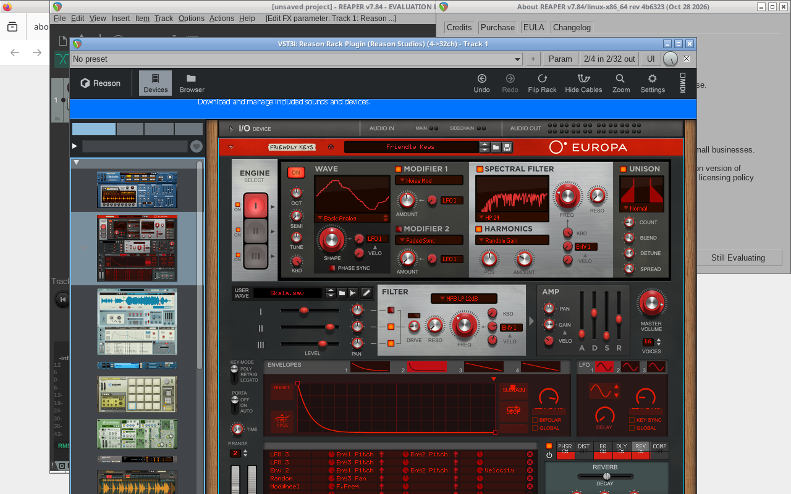

# Reason 14 on Linux via Wine + yabridge + REAPER

**English** | [中文](#中文说明)



> **Disclaimer.** Reason is a commercial product of Reason Studios AB. This repository contains **no** Reason binaries, installers, sound banks or licence data. You need your own Reason licence and Reason Studios account. This project is not affiliated with or endorsed by Reason Studios.

## Goal
Run the **Reason Rack Plugin** (Reason 14, Windows VST3) inside **native Linux REAPER** through Wine + yabridge. The whole setup can run headless (Xvfb), and REAPER/ReaScript builds and renders whole songs automatically.

## Tested environment
| Component | Version |
|---|---|
| OS | Debian 13 (trixie), x86_64 |
| Wine | 11.0 (WineHQ `winehq-stable`) |
| yabridge | master build, commit `b580a9f7fc46509767ca156d4f92872552b9e571` |
| DAW | REAPER 7.84 Linux x86_64 |
| Display | headless Xvfb, no GPU |
| Reason | Reason 14.1.0 (Rack Plugin VST3), official Windows installer |

## Quick start
1. Install Wine 11 stable (WineHQ) and create a prefix: `WINEPREFIX=~/wine-reason wineboot -u`
2. Install Reason 14 silently in that prefix and authorise it in Reason Companion (see §3 for the CDP login workaround).
3. Build yabridge from master (`b580a9f7`) — 5.1.1 breaks Rack menus on Wine ≥ 9.22.
4. `yabridgectl add "$WINEPREFIX/drive_c/Program Files/Common Files/VST3" && yabridgectl sync`
5. Start REAPER (Linux), rescan VST3, insert **Reason Rack Plugin**. Optional: run the `scripts/reaper/*.lua` ReaScripts to build/render songs headless.

## 1. Install Wine 11 (WineHQ stable)
```bash
sudo dpkg --add-architecture i386
sudo mkdir -pm755 /etc/apt/keyrings
sudo wget -O /etc/apt/keyrings/winehq-archive.key https://dl.winehq.org/wine-builds/winehq.key
sudo wget -NP /etc/apt/sources.list.d/ https://dl.winehq.org/wine-builds/debian/dists/trixie/winehq-trixie.sources
sudo apt update && sudo apt install --install-recommends winehq-stable
wine --version   # wine-11.0
export WINEPREFIX=~/wine-reason
wineboot -u
```
Headless: `Xvfb :2 -screen 0 1920x1080x24 & export DISPLAY=:2`.

## 2. Install Reason 14 silently
Download the official installer zip (needs your licence later):
```bash
wget -O reason_win.zip https://www.reasonstudios.com/updates_api/latest_reason_installer/win
unzip reason_win.zip -d reason_installer
WINEPREFIX=~/wine-reason wine reason_installer/*.exe /VERYSILENT /SUPPRESSMSGBOXES /NORESTART /SP-
```

## 3. Reason Companion login (keyboard workaround via Chrome DevTools Protocol)
Reason Companion (Electron) handles authorisation. Under Wine/Xvfb, typed text often never reaches its login fields. The workaround is to start it inside a Wine virtual desktop with the Chromium debug port enabled, then fill the form over CDP:
```bash
WINEPREFIX=~/wine-reason wine explorer /desktop=rc,1200x750 \
  "C:\\Program Files\\Reason Studios\\Reason Companion\\Reason Companion.exe" --remote-debugging-port=9222 &
pip install websocket-client
REASON_EMAIL=you@example.com python3 scripts/companion/cdp_login.py   # prompts for password
```
(Adjust the Companion path to match your install.) After login, authorise Reason 14 in Companion.

## 4. Build yabridge from master (fixes Rack menus on Wine ≥ 9.22)
With yabridge 5.1.1 on Wine ≥ 9.22, the Reason Rack's context menus and "Create device" menus do not open. Current master fixes this:
```bash
sudo apt install meson ninja-build gcc-multilib g++-multilib libxcb1-dev wine64-tools cargo  # plus wine dev headers
git clone https://github.com/robbert-vdh/yabridge && cd yabridge
git checkout b580a9f7fc46509767ca156d4f92872552b9e571
meson setup build --buildtype=release --cross-file=cross-wine.conf -Dbitbridge=false
ninja -C build
(cd tools/yabridgectl && cargo build --release)
mkdir -p ~/.local/share/yabridge
cp build/libyabridge-*.so build/yabridge-host.exe* tools/yabridgectl/target/release/yabridgectl ~/.local/share/yabridge/
~/.local/share/yabridge/yabridgectl add "$HOME/wine-reason/drive_c/Program Files/Common Files/VST3"
WINEPREFIX=~/wine-reason ~/.local/share/yabridge/yabridgectl sync
```
Follow the yabridge README for the exact build dependencies.

## 5. REAPER (Linux)
Install REAPER 7.84 for Linux x86_64 from reaper.fm. Add `~/.vst3` to its VST paths and rescan. **Reason Rack Plugin** shows up as a VST3i.

## 6. Scripting and rendering with ReaScript
`scripts/reaper/` has the Lua scripts used to build and render the demos. Scripts read `REASON_PROJ` (default `~/reaper_projects`).
```bash
export REASON_PROJ=~/reaper_projects DISPLAY=:2
timeout 600 reaper -nosplash -newinst -new scripts/reaper/reason_demo.lua
scripts/reaper/r2_run.sh scripts/reaper/r2_render.lua done   # sends the script to a running instance and waits for r2_done.txt
```
See [docs/REAPER_API_NOTES.md](docs/REAPER_API_NOTES.md) for the MP3 render blobs and headless pitfalls. `r2_gui.sh` holds the xdotool helpers used to add Rack devices. Its coordinates are screen-specific.

## Demos (`audio/`)
`reason_demo.mp3`, `reason_sound_design.mp3`, `reason_track2.mp3`, `moonlight_reason.mp3`. They were rendered headlessly with Reason Rack devices (Europa, Thor, Subtractor, Kong, Polytone, RV7000, MClass…).

## Known issues
- Companion keyboard input doesn't work under Wine/Xvfb. Use the CDP script.
- yabridge 5.1.1 + Wine ≥ 9.22: Rack menus don't open. Use yabridge master.
- Setting up the Rack itself is GUI-driven: there is no API for adding devices, so the scripts use xdotool with fixed coordinates.
- Modal REAPER dialogs ("save project?", "file exists", ReaScript errors) hang headless runs. Always use `timeout` and see the notes.
- Rack Extensions/licences need Companion authorisation, which needs network access.
- No GPU: the Rack GUI is software-rendered and slow, but it works.

## Licences
- Scripts and docs: MIT (see `LICENSE`).
- `audio/moonlight_reason.mp3`, `scripts/reaper/ml_notes.lua` and `third_party/mutopia/moonlight_mutopia_source.mid` are derived from the **Mutopia Project** edition of Beethoven's Piano Sonata No. 14 "Moonlight", 1st movement (source: Berners edition, 1908). Licence: **CC BY-SA 2.5** (https://creativecommons.org/licenses/by-sa/2.5/). Source: https://www.mutopiaproject.org/
- Other demo MP3s: MIT / free to use, like the scripts.

## Credits / links
- yabridge: https://github.com/robbert-vdh/yabridge
- WineHQ: https://wiki.winehq.org/Debian
- LinuxMusicians forum (Reason / yabridge threads): https://linuxmusicians.com/
- Reason Studios docs and Rack Plugin: https://www.reasonstudios.com/ · https://docs.reasonstudios.com/
- REAPER ReaScript: https://www.reaper.fm/sdk/reascript/reascript.php
- Mutopia Project: https://www.mutopiaproject.org/

---

## 中文说明

> **免责声明：**Reason 是 Reason Studios AB 的商业软件。本仓库**不含**任何 Reason 程序、安装包、音色库或授权数据。你需要自己的 Reason 授权和 Reason Studios 账号。本项目与 Reason Studios 无任何关联。

### 目标
在 **Linux 原生 REAPER** 中，通过 Wine + yabridge 运行 **Reason Rack Plugin**（Reason 14 的 Windows VST3），并且可以在无显示器、无 GPU 的服务器上（Xvfb）用 ReaScript 自动编曲和渲染。

### 测试环境
Debian 13、Wine 11.0（winehq-stable）、yabridge master（commit `b580a9f7`）、REAPER 7.84 Linux、Reason 14.1.0、Xvfb、无 GPU。


### 步骤
1. **安装 Wine 11：**添加 WineHQ 源，执行 `apt install --install-recommends winehq-stable`，然后 `WINEPREFIX=~/wine-reason wineboot -u`。
2. **静默安装 Reason 14：**从官方地址 `https://www.reasonstudios.com/updates_api/latest_reason_installer/win` 下载 zip 并解压，然后运行 `wine 安装程序.exe /VERYSILENT /SUPPRESSMSGBOXES /NORESTART /SP-`。
3. **登录 Companion：**在 Wine 下键盘输入无法到达登录框，所以要用 `wine explorer /desktop=rc,1200x750 ...Companion.exe --remote-debugging-port=9222` 启动，再运行 `scripts/companion/cdp_login.py`，通过 Chrome DevTools Protocol 填写账号和密码（密码在运行时输入，不会保存）。
4. **编译 yabridge master：**Wine ≥ 9.22 下，yabridge 5.1.1 打不开 Rack 的右键菜单和设备菜单，master 版本已修复。编译完成后执行 `WINEPREFIX=~/wine-reason yabridgectl sync`。
5. **REAPER：**安装 Linux 版 REAPER 7.84，扫描 VST3 后就能看到 “Reason Rack Plugin”。
6. **脚本与渲染：**`scripts/reaper/*.lua` 用 ReaScript 建轨、写 MIDI、设参数并渲染 MP3。命令示例：`timeout 600 reaper -nosplash -newinst -new 脚本.lua`。详见 `docs/REAPER_API_NOTES.md`。

### 已知问题
Companion 键盘输入失效（用 CDP 解决）；yabridge 5.1.1 菜单失效（用 master 解决）；Rack 里添加设备只能通过 GUI 操作（xdotool 坐标依赖屏幕）；REAPER 弹出的模态对话框会让无头运行卡住（务必加 `timeout`）；授权需要联网；没有 GPU 时界面较慢，但可以正常使用。

### 许可
脚本和文档采用 MIT 许可。月光奏鸣曲相关文件（`moonlight_reason.mp3`、`ml_notes.lua`、Mutopia MIDI）来自 Mutopia Project（Berners 1908 年版），采用 **CC BY-SA 2.5** 许可。
